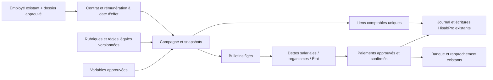

# Personnel & Paie — Lot 0B : proposition d'architecture

**Statut : proposition de conception à examiner ; aucun objet cible ci-dessous n'est réputé implémenté.** Les noms définitifs seront vérifiés au moment de chaque migration. Référence : master du 27/10/2026, Lots 0 à 7.

## 1. Navigation retenue pour le futur développement

Un groupe déroulant **Personnel & Paie** reprend le style de la sidebar actuelle. Ses neuf rubriques sont directement visibles lorsqu'il est déplié. La rubrique active est identifiée ; le groupe s'ouvre sur accès direct ; le menu mobile garde fermeture et navigation clavier. Une rubrique non livrée est indiquée « À venir », sans faux lien vers un écran utilisable. La visibilité dépend du module activé et des capacités, et les API portent les mêmes vérifications.

| Rubrique | Route cible indicative, non créée | Livraison |
|---|---|---|
| Personnel | `/personnel-paie/personnel` | Lot 1B |
| Éléments de paie | `/personnel-paie/elements` | Lot 2B |
| Traitement de la paie | `/personnel-paie/traitement` | Lot 3 |
| Charges sociales | `/personnel-paie/charges-sociales` | calcul Lot 3 ; déclarations Lot 5 |
| Fiscalité salariale | `/personnel-paie/fiscalite` | calcul Lot 3 ; déclarations Lot 5 |
| Avances & prêts | `/personnel-paie/avances-prets` | Lot 4 |
| Paiements | `/personnel-paie/paiements` | Lot 5 |
| Comptabilisation | `/personnel-paie/comptabilisation` | Lot 4, clôture Lot 6 |
| États & reporting | `/personnel-paie/etats` | Lot 6 |

Conserver le code de module `paie_grh`. Préserver `/cnss` pendant la transition ; définir ensuite une redirection explicite et testée. Le registre actuel d'absences reste exploitable comme source financière ; ne pas étendre son workflow vers un portail congés. Clôture et régularisations sont rattachées aux rubriques 08/09. Le Lot 0 ne modifie ni sidebar ni route.

## 2. Domaines et source de vérité

Les tableaux de paie expliquent les montants ; le grand livre reste la source des soldes comptables. Un statut de dépôt/paiement dépend d'une preuve d'action effective, pas d'un clic ou d'une transmission. Une approbation de campagne ne valide pas automatiquement une écriture comptable.

## 3. Modèle cible par petites extensions

Toutes les nouvelles relations métier multi-sociétés portent `societe_id NOT NULL` et des FK composites `(objet_id,societe_id)` vers une clé unique correspondante. Les identités/versions utilisées dans un snapshot ne sont pas supprimées en cascade.

| Ensemble cible | Données et contraintes principales | Lot |
|---|---|---|
| Extension dossier de `employes` | Relation 1:1 `(employe_id,societe_id)`, statut, révision de concurrence, auteurs, dates, origine historique. Conserver la racine `employes` et ses anciens liens. | 1A |
| Versions de contrats | Type, dates connues, justificatif, préparation/approbation ; les informations historiques inconnues restent nulles et visibles. | 1A |
| Versions de rémunération | Montant `Numeric(18,2)`, périodicité, devise MAD, date d'effet attestée, statut, version et approbateur. Unicité version par salarié/société ; pas de chevauchement de versions approuvées d'un même composant. | 1A |
| Demandes et événements Personnel | Changement typé, révision attendue, préparateur/approbateur/motif, audit append-only ; aucun RIB/CIN complet dans les logs généraux. | 1A/1C |
| Habilitations Personnel | Société/utilisateur/capacité et éventuel périmètre, validité/révocation, donneur et trace. Fonction métier distincte du rôle global historique. | socle 1A, recette 1C |
| Identifiants de paiement et pièces salarié | Valeurs sensibles chiffrées et versionnées, masque serveur, empreinte de détection des changements, pièce et approbation indépendante. Ne pas ajouter un RIB en clair à `EmployeOut`. | 1, après décision de gestion des clés |
| Rubriques, versions et variables | Code/type/formule contrôlée, assiettes séparées, conditions/plafonds par régime, références et périodes ; pas d'`eval` de formules utilisateur. Variables uniques selon salarié/période/type/source et justification. | 2 |
| Sources et règles légales | Référence, texte/article, URL, preuve, dates d'application/validation et validateur ; statuts à vérifier/validé/obsolète. Les snapshots de preuves 082 restent conservés séparément. | 2/3 |
| Campagnes, bulletins et lignes | Type normale/complémentaire, période réelle, clé unique d'ordinaire par société/période/type, snapshots exacts, version de règles et arrondis, empreinte. Versions complémentaires explicites, pas un deuxième ordinaire après timeout. | 3 |
| Avances/prêts et échéances | Demande/approbation/décaissement/recouvrement et solde. Référencer le registre 095 et les lignes comptables historiques sans les réécrire ; aucune avance supposée depuis un texte libre. | 4 |
| Liens comptables | `(societe_id,source_type,source_id,version,operation)` unique, FK écriture, acteur et empreinte du snapshot. Deux requêtes concurrentes retournent le lien existant ou un conflit, jamais deux OD. | 4 |
| Dettes, déclarations et paiements liés | Bénéficiaire réel, organisme, échéance justifiée, confirmation et pièces, solde exact, référence bancaire ; pas de rattachement factice à une facture commerciale. | 5 |
| Charges à payer / extournes | Base documentaire, absence de doublon avec paie, proposition/validation, lien OD et extourne de N+1 si applicable. | 6 |
| Imports externes | Fichier conservé, hash, mapping, anomalies, approbation et lien comptable idempotent. | 7 |

Les montants nouveaux sont exacts jusqu'à la base et au contrat API : décimaux validés sans booléens/NaN/infinis, sérialisation en chaîne décimale pour éviter un aller-retour monétaire en `Number`. Les taux/formules ont une précision dédiée documentée, distincte du centime MAD. La politique d'arrondi reste à définir et tester avec les dossiers de référence avant Lot 3.

## 4. Reprise et compatibilité du Personnel

Ne pas convertir le salaire historique flottant en montant « exact attesté » ni déduire sa date d'effet de `created_at`. Une extension peut mémoriser la source brute et son origine, sans la qualifier. La rémunération courante destinée à la paie devra être confirmée avec un montant décimal, une date d'effet et un approbateur.

Conserver `actif`, le salaire et les données de l'ancien dossier jusqu'au basculement contrôlé. `actif` historique ne devient pas automatiquement `ACTIF` approuvé. Les nouveaux brouillons n'entrent jamais dans la paie définitive. Un éventuel brouillon sans montant ne doit pas recevoir un faux salaire zéro pour satisfaire l'ancienne colonne non nulle : cet usage nécessite un contrat d'API/compatibilité explicite avant développement.

À l'activation du nouveau service, toutes les anciennes routes de lecture/écriture Personnel doivent passer par les mêmes autorisations et contrôles de version ; pas de `PUT` historique capable de contourner une approbation. Préserver les URL n'implique pas de conserver leur ancien droit de modifier immédiatement un salaire. Un conflit explicite est préférable à une mise à jour silencieuse ; cette évolution devra être expliquée et testée avec les écrans historiques lors du basculement.

Matricule : proposition d'unicité par société après normalisation des espaces de bord, références conservées comme texte. Ne pas transformer `02` en `2`. Avant index unique, préflight des valeurs nulles, doublons et collisions ; si les historiques sont ambigus, bloquer cette contrainte et produire un diagnostic autorisé. Aucun matricule inventé, aucun doublon arbitrairement fusionné.

## 5. Transactions, approbations et confidentialité

- Les transitions sont explicites et contrôlées en base/service : dossier `BROUILLON → A_VALIDER → ACTIF`, puis suspendu/sorti ; les retours/rejets portent un motif et un événement. La sortie ne supprime pas l'historique.
- Changement salarial/RIB/campagne/paiement : acteur indépendant du préparateur pour l'approbation sensible ; un admin ne contourne pas cette règle. Le bénéficiaire salarié ne peut approuver sa propre opération sensible.
- Contrôle optimiste `revision_attendue` et verrouillage de la racine lors de l'approbation ; une révision concurrente invalide la demande. Vérification des dates d'effet et chevauchements dans la même transaction.
- Les nouvelles données confidentielles sont protégées au backend, sur listes, détails, exports et anciennes URL ; audit métier réservé et sans corps sensible dans l'audit HTTP.
- Une fiche créée/modifiée, un contrat ou une variable ne créent aucune écriture comptable.
- Au Lot 4, création du lien comptable et de l'OD dans une même transaction ; pas d'appel HTTP interne à une route qui commit séparément. La validation comptable reste une opération autorisée distincte.
- La clé d'idempotence et les contraintes SQL complètent les verrous ; permissions SQL applicatives minimales, rôle migrateur séparé. Un verrou côté React ne protège pas une API.
- Fichiers bancaires/déclarations : seulement préparation, approbation et preuve de transmission/exécution, selon format réellement vérifié. Aucun paiement ou dépôt réel autorisé par ce document.

## 6. RBAC : choix de déploiement à examiner

La [matrice cible](LOT0_RBAC.csv) définit des capacités et fonctions métier ; ce ne sont pas sept valeurs à injecter dans le rôle global. Légende : **H** = habilitation explicite requise, jamais un droit automatique du seul intitulé de rôle ; **M** = projection minimale/masquée, sans valeur sensible complète ; **-** = capacité non prévue pour cette fonction. Une capacité ne remplace jamais les contrôles société, acteur indépendant et périmètre d'objet. Les colonnes des fonctions de lots ultérieurs sont des cibles de conception.

`auth.py` revalide les trois rôles actuels et les droits société ; les autres rôles deviennent lecture. Donner `comptable` à un gestionnaire Personnel ouvrirait aussi des droits comptables hors paie : cette assimilation est exclue.

**Proposition pour le socle 1A** : capacités Personnel par utilisateur/société, révocables et fermées par défaut ; pilote limité à des utilisateurs déjà légitimement admin/comptable, avec habilitations explicites. L'admin peut administrer les habilitations, sans droit implicite sur les approbations financières ou l'export sensible. Aucun nouveau profil « Personnel seul » n'est présenté comme livré tant que son confinement hors du module n'est pas construit et testé.

Pour un accès Personnel seul, deux options restent à examiner : permissions par module étendues aux routes existantes, ou nouveau profil global cantonné avec refus par défaut hors des routes communes strictement nécessaires. Cela touche authentification, rôles SQL, gestion des utilisateurs et frontend ; une simple nouvelle valeur `role` serait insuffisante, y compris pour les lectures des autres modules. Ce choix ne doit pas être improvisé dans une migration de dossiers salariés.

## 7. Décisions à conserver

| ID | Proposition / décision nécessaire | Échéance |
|---|---|---|
| D01 | Examiner le pilote de capacités explicites et la stratégie du profil Personnel seul. | avant activation 1A ; profil cloisonné avant son usage |
| D02 | Conservation du journal `SA` proposée ; `PAI` exigerait une évolution dédiée de l'enum et de ses dépendances. | avant Lot 4 |
| D03 | Deux personnes pour les validations sensibles ; cas d'entreprise à utilisateur unique à décider explicitement, sans auto-approbation implicite. | avant 1C / usage réel |
| D04 | Proposition d'OD centralisée + détail salarial restreint ; détail par salarié à examiner selon confidentialité et besoins. | avant Lot 4 |
| D05 | Hébergement des clés, chiffrement, rotation et durée de conservation des données/pièces de paie. | avant collecte des coordonnées sensibles |
| D06 | Bulletins, conventions, plafonds/conditions, arrondis, entrées/sorties et retenues : dossiers de référence et sources officielles consolidées. | avant calcul validable Lot 3 |
| D07 | Formats bancaires et déclaratifs effectivement disponibles ; transmission/exécution manuelles ou intégrées selon preuves. | avant Lot 5 |
| D08 | L'import externe reste Lot 7 ; aucun changement de priorité sans instruction utilisateur. | inchangé |

Les comptes proposés au §12 du master sont un mapping candidat à vérifier dans le plan actif de chaque société et sur les références comptables applicables avant Lot 4. Ce Lot 0 n'a validé aucun compte ni taux comme obligation légale nouvelle.
